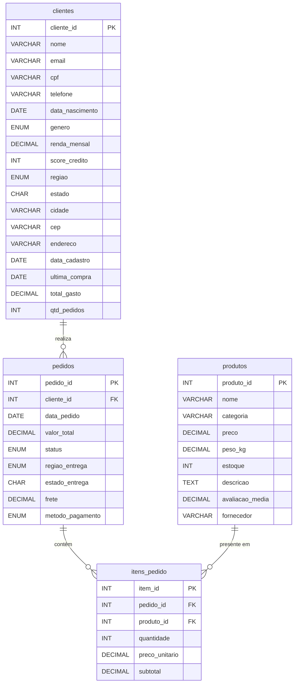

# 🗄️ Replicação e Fragmentação de Dados em Bancos Distribuídos

> **Objetivo:** observar na prática a **replicação primário–réplica** entre dois servidores MySQL e aplicar as estratégias de **fragmentação horizontal, vertical e híbrida**, avaliando o impacto de cada uma nas consultas e na proteção de dados (LGPD).

**Disciplina:** Infraestrutura para Big Data  
**Público:** Graduação em Ciência de Dados  
🕐 **Tempo total estimado:** cerca de 2 horas e 40 minutos  
👥 **Formato:** individual, com discussão em grupo na Parte 8  
💻 **Ambiente:** GitHub Codespaces (sem instalação e sem custo)  
📦 **Entrega:** um único PDF com as 15 evidências, pelo **Microsoft Teams**

> ℹ️ **Versão 2 (outubro/2026).** A AWS Academy deixou de permitir a criação de bancos Amazon Aurora. Nesta versão, o cluster na nuvem foi substituído por **dois servidores MySQL 8.4 em contêineres**, criados automaticamente no seu Codespace, com a mesma replicação assíncrona usada pelas réplicas de leitura do Amazon RDS for MySQL e do Azure Database for MySQL. Os conceitos e as tarefas de fragmentação são os mesmos.

---

## 🎯 Objetivos de Aprendizagem

Ao final deste laboratório, você será capaz de:

- **Explicar a arquitetura replicada** de um banco MySQL, com uma instância de escrita (**Writer**) e uma de leitura (**Reader**).
- **Conectar-se às duas instâncias ao mesmo tempo**, simulando uma aplicação que separa escritas e leituras.
- **Carregar e validar dados**, garantindo a consistência entre as instâncias via replicação.
- **Observar a replicação por dentro** — binlog, GTID e as threads de I/O e SQL — e **tornar visível a latência de replicação** com uma réplica atrasada de propósito.
- **Aplicar fragmentação horizontal**, dividindo linhas por critério geográfico e temporal.
- **Aplicar fragmentação vertical**, separando colunas por sensibilidade (LGPD) e frequência de acesso.
- **Aplicar fragmentação híbrida**, combinando as duas estratégias.
- **Escolher entre replicação, sharding e fragmentação** pelos seus impactos em desempenho.

---

## 🧠 Revisão Teórica

Antes de iniciar a parte prática, é fundamental compreender os conceitos que sustentam as técnicas de distribuição de dados exploradas neste laboratório.

### Replicação de Dados

A **replicação** consiste em manter **cópias idênticas** dos dados em dois ou mais nós de um sistema distribuído. A motivação principal é garantir **alta disponibilidade** e **escalabilidade de leitura**: se um nó falha, outro assume; se a carga de consultas cresce, mais réplicas podem ser adicionadas para distribuí-la.

O modelo mais comum é o **primário–réplica** (*primary–replica*, antes chamado de *master–slave*, termo em desuso):

| Papel | Responsabilidade |
|-------|-----------------|
| **Primário (Writer)** | Recebe **todas** as operações de escrita (`INSERT`, `UPDATE`, `DELETE`). É a fonte da verdade. |
| **Réplica (Reader)** | Recebe uma cópia dos dados do primário por meio de replicação (síncrona ou assíncrona). Atende apenas operações de leitura (`SELECT`). |

**Características importantes:**

- **Replicação síncrona:** a escrita só é confirmada quando todas as réplicas recebem os dados. Garante consistência forte, mas com maior latência.
- **Replicação assíncrona:** a escrita é confirmada assim que o primário registra a operação; as réplicas são atualizadas em segundo plano. Menor latência, porém existe uma janela de **inconsistência eventual** (a **latência de replicação**).
- A replicação **escala leituras**, mas **não escala escritas** — todas as gravações ainda passam por um único nó.

### Como a replicação funciona no MySQL

Neste laboratório, a réplica é atualizada de forma **assíncrona** pelo **log binário** (*binlog*) do primário:

```
        mysql-writer (primário)                         mysql-reader (réplica)
┌──────────────────────────────────┐           ┌──────────────────────────────────────┐
│ INSERT / UPDATE / DELETE / CREATE│           │                                      │
│               │                  │           │  thread de I/O ──► relay log         │
│               ▼                  │  binlog   │  (recebe os eventos)     │           │
│   binlog (eventos + GTID) ───────┼──────────►│                          ▼           │
│                                  │           │  thread SQL ──► tabelas da réplica   │
│                                  │           │  (aplica os eventos)                 │
└──────────────────────────────────┘           └──────────────────────────────────────┘
```

- **Binlog:** registro, em ordem, de todas as mudanças feitas no primário.
- **GTID** (*Global Transaction Identifier*): identificador único de cada transação. Com ele, a réplica sabe exatamente o que já aplicou e de onde continuar — inclusive depois de ficar um tempo fora do ar.
- **Thread de I/O:** busca os eventos do binlog do primário e os grava no *relay log* da réplica.
- **Thread SQL:** lê o relay log e aplica as mudanças nas tabelas da réplica.

### Fragmentação (Particionamento) de Dados

A **fragmentação** (ou *particionamento*) consiste em **dividir** uma tabela em subconjuntos menores, chamados **fragmentos**, que podem ser armazenados em nós distintos. Diferente da replicação, cada nó contém apenas uma **parte** dos dados.

Toda fragmentação deve obedecer a **três regras fundamentais**:

| Regra | Definição |
|-------|-----------|
| **Completude** | A união de todos os fragmentos deve reconstituir a tabela original na íntegra — nenhum dado pode ser perdido. |
| **Disjunção** | Não pode haver sobreposição — cada linha (ou coluna, conforme o tipo) pertence a **exatamente um** fragmento. Na fragmentação vertical, a exceção é a chave primária, que se repete em todos os fragmentos. |
| **Reconstrução** | Deve ser possível recompor a tabela original a partir dos fragmentos, usando `UNION ALL` (horizontal) ou `JOIN` (vertical). |

#### Fragmentação Horizontal

Na fragmentação horizontal, a tabela é dividida por **linhas**. Cada fragmento possui o **mesmo esquema** (mesmas colunas), mas contém um **subconjunto dos registros**, selecionado por um critério como região geográfica, faixa de datas ou faixa de valores.

```
┌──────────────────────────┐
│     TABELA ORIGINAL      │
│  (todas as linhas)       │
└────────┬─────────────────┘
         │  critério: região
    ┌────┼────────┐
    ▼    ▼        ▼
┌───────┐┌───────┐┌──────────┐
│SUDESTE││  SUL  ││NORDESTE  │
│(linhas││(linhas││(linhas   │
│ SE)   ││ S)    ││ NE)      │
└───────┘└───────┘└──────────┘
```

**Quando usar:** consultas que filtram por um atributo natural de partição (região, data), permitindo acessar apenas o fragmento relevante (*consulta local*).

**Trade-off:** consultas que cruzam fragmentos (*consultas distribuídas*) ficam mais custosas, pois exigem comunicação entre nós e consolidação de resultados.

#### Fragmentação Vertical

Na fragmentação vertical, a tabela é dividida por **colunas**. Cada fragmento contém a **chave primária** (obrigatória para reconstrução) e um **subconjunto das colunas**, agrupadas por critérios como sensibilidade, frequência de acesso ou domínio funcional.

```
┌───────────────────────────────────┐
│          TABELA ORIGINAL          │
│ PK | nome | email | cpf | renda   │
└────────┬──────────────────────────┘
         │  critério: sensibilidade
    ┌────┴────────────┐
    ▼                 ▼
┌──────────────┐ ┌───────────────┐
│PERFIL PÚBLICO│ │DADOS SENSÍVEIS│
│PK|nome|email │ │ PK|cpf|renda  │
└──────────────┘ └───────────────┘
```

**Quando usar:**
- **Proteção de dados (LGPD):** isolar dados pessoais confidenciais em um fragmento com controle de acesso restrito.
- **Otimização de desempenho:** manter colunas acessadas com frequência ("quentes") separadas de colunas raramente consultadas ("frias"), aproveitando melhor o cache.

**Trade-off:** consultas que necessitam de colunas presentes em fragmentos distintos exigem `JOIN`, aumentando o custo de processamento.

#### Fragmentação Híbrida

Na prática, as duas estratégias são **combinadas**. Primeiro aplica-se a fragmentação vertical (separando colunas por domínio) e depois a horizontal (dividindo cada fragmento vertical por região ou data) — ou vice-versa.

### Replicação vs. Sharding

| Aspecto | Replicação | Sharding |
|---------|-----------|----------|
| **Dados em cada nó** | Cópia completa (idêntica) | Subconjunto (fragmento) |
| **Escala** | Leituras | Leituras **e** escritas |
| **Consistência** | Alta (um primário) | Mais complexa (coordenação entre shards) |
| **Caso de uso** | Leitura >> Escrita (ex.: catálogo de produtos) | Volume ou escrita excedem a capacidade de um servidor |

> **Neste laboratório**, a replicação é **real** (dois servidores MySQL, um copiando o outro) e a fragmentação é **simulada**: os "nós" de cada fragmento são tabelas separadas dentro do mesmo banco.

---

## 🏪 Contexto do Cenário

Uma empresa de e-commerce opera em 3 regiões do Brasil (**Sul**, **Sudeste**, **Nordeste**). O volume de dados cresceu e a empresa precisa:

1. **Distribuir a carga de leitura** usando réplicas de leitura, garantindo que consultas analíticas não sobrecarreguem a instância de escrita.
2. **Fragmentar os dados** entre nós regionais para otimizar consultas locais e atender requisitos de proteção de dados (LGPD).

---

## 🏗️ Arquitetura do Ambiente

Ao abrir o Codespace, dois contêineres Docker sobem automaticamente:

```
                         Seu Codespace (Linux na nuvem)
┌─────────────────────────────────────────────────────────────────────────┐
│                                                                         │
│  Terminal 1                                                             │
│  $ sessao-a ──── escritas ────► mysql-writer  (porta 3306)              │
│                                 primário · read_only = 0                │
│                                        │                                │
│                                        │ replicação assíncrona          │
│                                        │ (binlog + GTID)                │
│                                        ▼                                │
│  Terminal 2                                                             │
│  $ sessao-b ──── leituras ────► mysql-reader  (porta 3307)              │
│                                 réplica · read_only = 1                 │
│                                                                         │
└─────────────────────────────────────────────────────────────────────────┘
```

| | Sessão A | Sessão B |
|---|---|---|
| **Comando** | `sessao-a` | `sessao-b` |
| **Servidor** | `mysql-writer` (porta 3306) | `mysql-reader` (porta 3307) |
| **Papel** | Primário — recebe as escritas | Réplica — somente leitura |
| **Use para** | `CREATE`, `INSERT`, `UPDATE`, `DELETE`, `DROP` | `SELECT` e conferências |
| **Prompt** | `SESSAO-A writer [...]>` | `SESSAO-B reader [...]>` |

> **E na nuvem?** Em um serviço gerenciado (Amazon RDS, Azure Database for MySQL, Amazon Aurora), a aplicação recebe um **endpoint de gravação** e um **endpoint de leitura**. Aqui, as portas 3306 e 3307 fazem esse papel. Em produção, o próprio driver ou um proxy separa escritas e leituras; neste laboratório, você faz isso à mão, com duas sessões.

### O que há neste repositório

| Caminho | Para que serve |
|---------|----------------|
| `.devcontainer/` | Configuração do Codespace: Ubuntu com Docker (*docker-in-docker*), cliente MySQL e a subida automática dos servidores |
| `docker-compose.yml` | Define os contêineres `mysql-writer` e `mysql-reader` (MySQL 8.4) |
| `mysql/writer/`, `mysql/reader/` | Scripts executados na criação de cada servidor: usuários e configuração da replicação |
| `bin/` | Comandos do laboratório: `sessao-a`, `sessao-b`, `status-lab`, `atraso-replicacao`, `reiniciar-lab`, `ajuda-lab` |
| `config/` | Credenciais usadas pelos comandos (senhas fixas, **apenas para o laboratório**) |
| `sql/criar_banco_ecommerce.sql` | Script de criação e carga do banco `ecommerce_central` |

---

## 🛠️ Parte 1 — Preparação do Ambiente (15 min)

### Tarefa 1.1 — Fazer o fork do repositório

1. Tenha uma conta no **GitHub** e faça login.
2. Na página do repositório institucional ([`fatec-cd/bd-distribuido`](https://github.com/fatec-cd/bd-distribuido)), clique em **Fork → Create fork**, mantendo a sua conta pessoal como *Owner*.

> **Por que o fork?** O Codespace criado a partir do **seu** fork pertence à sua conta: usa a sua franquia gratuita e segue as suas configurações, e não as políticas da organização `fatec-cd`, que podem bloquear a criação do ambiente.

### Tarefa 1.2 — Criar o Codespace

1. Confira que você está no **seu fork** (o endereço deve ser `github.com/<seu-usuario>/bd-distribuido`).
2. Clique em **Code → Codespaces → Create codespace on main**.
3. Aguarde. Na **primeira** criação, o ambiente instala o cliente MySQL, baixa a imagem do MySQL e inicializa os dois servidores — isso leva **alguns minutos**. O Codespace só abre o editor quando tudo estiver pronto.

### Tarefa 1.3 — Conferir o ambiente

No terminal do Codespace, execute:

```bash
status-lab
```

Você deve ver os dois contêineres como `healthy`, o `mysql-writer` com `read_only = 0`, o `mysql-reader` com `read_only = 1` e as duas threads da replicação com `Yes`:

```
== Servidores ==
servidor       porta   server_id  read_only  super_read_only
mysql-writer   3306    1          0          0
mysql-reader   3307    2          1          1

== Replicação (mysql-reader ← mysql-writer) ==
Yes    Thread de I/O: recebe o binlog do writer
Yes    Thread SQL: aplica as mudanças na réplica
...
✔ Replicação funcionando
```

> **📸 Evidência 1:** *screenshot* da saída completa do `status-lab`.

### Tarefa 1.4 — Abrir as duas sessões lado a lado

1. No painel do terminal, clique no ícone **Split Terminal** (ou pressione `Ctrl+Shift+5`) para ter dois terminais lado a lado.
2. No terminal da **esquerda**, abra a **Sessão A (Writer)**:
   ```bash
   sessao-a
   ```
3. No terminal da **direita**, abra a **Sessão B (Reader)**:
   ```bash
   sessao-b
   ```
4. Em **cada** sessão, execute:
   ```sql
   SELECT @@hostname AS servidor, @@server_id, @@read_only, @@super_read_only;
   ```

> **📸 Evidência 2:** *screenshot* das duas sessões lado a lado, com os prompts `SESSAO-A writer` e `SESSAO-B reader` e o resultado da consulta em cada uma.

> **Mantenha as duas sessões abertas durante todo o laboratório.** Todas as operações de escrita (`CREATE`, `INSERT`, `ALTER`, `DROP`) serão executadas na **Sessão A (Writer)**. As leituras e verificações serão executadas na **Sessão B (Reader)** para comprovar a replicação. Se fechar uma sessão (`exit`), basta rodar o comando de novo.

---

## 🧱 Parte 2 — Criação e Carga do Banco Centralizado (10 min)

Nesta etapa você criará o banco centralizado que servirá de base para todas as fragmentações.

### Modelo de Dados

O diagrama abaixo mostra as 4 tabelas do banco `ecommerce_central` e seus relacionamentos:



> **Observe a tabela `clientes`:** identifique quais colunas são *públicas* (nome, cidade...) e quais são *confidenciais* (CPF, renda, score). Isso será importante na fragmentação vertical.

### Tarefa 2.1 — Executar o script de criação e carga (Sessão A — Writer)

Na **Sessão A**, execute o script com o comando `source` do cliente MySQL:

```sql
source sql/criar_banco_ecommerce.sql
```

Ao final, o script mostra a contagem das tabelas. O banco `ecommerce_central` terá:
- **4 tabelas:** `clientes`, `produtos`, `pedidos`, `itens_pedido`
- **30 clientes** (10 por região: Sudeste, Sul, Nordeste)
- **20 produtos**
- **60 pedidos** (20 por região)
- **85 itens de pedido**

> **Atenção:** o script começa com `DROP DATABASE IF EXISTS`. Executá-lo de novo **apaga o banco**, inclusive os fragmentos que você criar nas Partes 4 a 7.

### Tarefa 2.2 — Tentar escrever na réplica (Sessão B — Reader)

Na **Sessão B**, tente apagar um item de pedido:

```sql
DELETE FROM ecommerce_central.itens_pedido WHERE item_id = 1;
```

O Reader recusa o comando:

```
ERROR 1290 (HY000): The MySQL server is running with the --read-only option so it cannot execute this statement
```

> O usuário `aluno` tem **as mesmas permissões** nos dois servidores. Quem impede a escrita é o **modo somente leitura** (`read_only`) da réplica: toda mudança precisa passar pelo Writer, a fonte da verdade.

> **📸 Evidência 3:** *screenshot* do erro na **Sessão B**.

---

## 🔄 Parte 3 — Validação dos Dados e Teste da Replicação (20 min)

Nesta etapa vamos confirmar que os dados foram carregados e comprovar que a **replicação** entre Writer e Reader está funcionando.

### Tarefa 3.1 — Visão geral do banco (Sessão A — Writer)

Execute a consulta abaixo na **Sessão A (Writer)** e anote os resultados:

```sql
USE ecommerce_central;

SELECT 'clientes'     AS tabela, COUNT(*) AS registros FROM clientes
UNION ALL
SELECT 'produtos',     COUNT(*) FROM produtos
UNION ALL
SELECT 'pedidos',      COUNT(*) FROM pedidos
UNION ALL
SELECT 'itens_pedido', COUNT(*) FROM itens_pedido;
```

> **Resultado esperado:** 30 clientes, 20 produtos, 60 pedidos, 85 itens.

> **📸 Evidência 4:** *screenshot* do resultado desta consulta na **Sessão A (Writer)**.

### Tarefa 3.2 — Validação da Replicação (Sessão B — Reader)

Agora execute **exatamente a mesma consulta** na **Sessão B (Reader)**, começando pelo `USE ecommerce_central;`.

> **Os resultados devem ser idênticos aos da Sessão A!** Nenhum comando de carga foi executado no Reader: os dados chegaram pela replicação.

> **📸 Evidência 5:** *screenshot* do resultado na **Sessão B (Reader)**, com as contagens idênticas às da Sessão A.

### Tarefa 3.3 — Distribuição por região (Sessão B — Reader)

Execute as consultas abaixo na **Sessão B (Reader)** para entender a distribuição dos dados:

```sql
SELECT regiao, COUNT(*) AS total_clientes
FROM clientes
GROUP BY regiao
ORDER BY total_clientes DESC;
```

```sql
SELECT regiao_entrega, COUNT(*) AS total_pedidos,
       ROUND(SUM(valor_total),2) AS receita_total
FROM pedidos
GROUP BY regiao_entrega
ORDER BY receita_total DESC;
```

> **Reflexão:** A distribuição é equilibrada entre as regiões? Compare a contagem de linhas com a receita. Isso é importante para a fragmentação horizontal: se uma região concentrar a maior parte dos dados ou dos acessos, o nó dela fica sobrecarregado (um *hotspot*).

### Tarefa 3.4 — Olhando a replicação por dentro (Sessão B — Reader)

Na **Sessão B**, execute:

```sql
SHOW REPLICA STATUS\G
```

O `\G` mostra o resultado na vertical. Localize os campos:

| Campo | O que mostra |
|-------|--------------|
| `Source_Host` | De qual servidor a réplica copia (`mysql-writer`) |
| `Replica_IO_Running` | Se a thread de I/O está recebendo o binlog (`Yes`) |
| `Replica_SQL_Running` | Se a thread SQL está aplicando as mudanças (`Yes`) |
| `Seconds_Behind_Source` | Atraso estimado da réplica, em segundos |
| `Retrieved_Gtid_Set` / `Executed_Gtid_Set` | Transações (GTIDs) recebidas e já aplicadas |

> **Reflexão:** compare o `Executed_Gtid_Set` da réplica com o resultado de `SELECT @@gtid_executed;` na **Sessão A**. O que significa os dois serem iguais?

### Tarefa 3.5 — Teste de replicação com atraso proposital

Entre servidores tão próximos, a replicação costuma levar milissegundos — rápido demais para ser visto. Por isso, vamos **atrasar a réplica de propósito** em 10 segundos (recurso real do MySQL, a *delayed replication*, usado em produção para ter uma cópia "no passado" que protege contra erros humanos, como um `DROP` acidental).

1. **Na Sessão B**, ligue o atraso. O `\!` executa um comando do terminal sem sair do MySQL:
   ```sql
   \! atraso-replicacao 10
   ```
2. **Na Sessão A (Writer)**, insira um cliente temporário:
   ```sql
   INSERT INTO clientes (nome, email, cpf, regiao, estado, cidade, data_cadastro)
   VALUES ('Cliente Teste Replicação', 'teste@teste.com', '000.000.000-00',
           'Sudeste', 'SP', 'São Paulo', CURDATE());
   ```
3. **Imediatamente na Sessão B (Reader)**, busque o registro:
   ```sql
   SELECT cliente_id, nome, email, regiao
   FROM clientes
   WHERE nome = 'Cliente Teste Replicação';
   ```
   O resultado deve ser `Empty set`: o Writer já confirmou a escrita, mas a réplica ainda não a aplicou.
4. Ainda na **Sessão B**, veja a contagem regressiva:
   ```sql
   \! status-lab
   ```
   O campo **"Faltam para aplicar o próximo evento"** mostra quantos segundos faltam.
5. Depois de ~10 segundos, repita o `SELECT` do item 3. O registro aparece! Essa janela entre a escrita no primário e a chegada à réplica é a **latência de replicação** — aqui, ampliada de propósito.
6. Desligue o atraso:
   ```sql
   \! atraso-replicacao 0
   ```

> **📸 Evidência 6:** *screenshot* da **Sessão B** mostrando o `Empty set` (item 3) e, logo abaixo, o registro encontrado (item 5). Se possível, deixe a Sessão A visível ao lado, com o `INSERT`.

> **Importante:** confira que o atraso voltou a **0** antes de continuar. Com o atraso ligado, as tabelas criadas nas próximas partes demoram 10 segundos para aparecer no Reader.

### Tarefa 3.6 — Remover o registro de teste (Sessão A — Writer)

Limpe o registro temporário para não interferir nas próximas etapas:

```sql
DELETE FROM clientes WHERE nome = 'Cliente Teste Replicação';
```

> **Verifique na Sessão B (Reader):** o registro também desaparece da réplica.

### Tarefa 3.7 (opcional) — A réplica fora do ar

O que acontece se a réplica cair enquanto o Writer continua recebendo escritas?

1. **Na Sessão A**, desligue o contêiner da réplica:
   ```sql
   \! docker compose stop mysql-reader
   ```
2. **Na Sessão A**, insira um cliente (troque o nome para `'Cliente Réplica Fora'` no `INSERT` da Tarefa 3.5).
3. **Na Sessão A**, ligue a réplica de novo e aguarde alguns segundos:
   ```sql
   \! docker compose start mysql-reader
   ```
4. **Na Sessão B**, busque o cliente `'Cliente Réplica Fora'`. Como o servidor reiniciou, o cliente MySQL reconecta sozinho antes de executar a consulta (se aparecer um erro de conexão, repita o comando).

> **Reflexão:** a réplica ficou parada, mas o registro chegou. Como ela sabia de onde continuar? (Dica: GTID.) Ao terminar, apague o registro na **Sessão A**.

---

## ↔️ Parte 4 — Fragmentação Horizontal (25 min)

> **A partir desta parte, todos os comandos de criação de tabela (`CREATE TABLE`) e escrita devem ser executados na Sessão A (Writer).** Após a execução, você pode verificar na Sessão B (Reader) que as tabelas foram replicadas.

### Conceito

Dividir as **linhas** de uma tabela entre fragmentos com base em um critério (geralmente geográfico, temporal ou por faixa de valores). Cada fragmento possui o **mesmo esquema**, mas um **subconjunto das linhas**.

**Três regras fundamentais:**

| Regra | Descrição |
|-------|-----------|
| **Completude** | A união de todos os fragmentos = tabela original |
| **Disjunção** | A interseção entre fragmentos = vazio (sem duplicatas) |
| **Reconstrução** | `SELECT * FROM frag1 UNION ALL SELECT * FROM frag2 ...` reconstrói o original |

> **Analogia:** É como dividir uma lista telefônica por bairro. Cada bairro tem a mesma estrutura (nome, telefone, endereço), mas cada livro só contém os moradores daquele bairro.

### Tarefa 4.1 — Criar fragmentos horizontais da tabela `clientes` por região (Sessão A — Writer)

Simularemos 3 "nós regionais". Cada nó armazena apenas os clientes de sua região.

```sql
-- NÓ SUDESTE
CREATE TABLE clientes_sudeste AS
SELECT * FROM clientes WHERE regiao = 'Sudeste';

-- NÓ SUL
CREATE TABLE clientes_sul AS
SELECT * FROM clientes WHERE regiao = 'Sul';

-- NÓ NORDESTE
CREATE TABLE clientes_nordeste AS
SELECT * FROM clientes WHERE regiao = 'Nordeste';
```

> `CREATE TABLE ... AS SELECT` copia as colunas e as linhas, mas **não** copia a chave primária, os índices nem o `AUTO_INCREMENT`. Em um sistema real, cada fragmento teria a sua chave declarada.

### Tarefa 4.2 — Criar fragmentos horizontais da tabela `pedidos` por região (Sessão A — Writer)

```sql
CREATE TABLE pedidos_sudeste AS
SELECT * FROM pedidos WHERE regiao_entrega = 'Sudeste';

CREATE TABLE pedidos_sul AS
SELECT * FROM pedidos WHERE regiao_entrega = 'Sul';

CREATE TABLE pedidos_nordeste AS
SELECT * FROM pedidos WHERE regiao_entrega = 'Nordeste';
```

### Tarefa 4.3 — Verificar a contagem por fragmento (Sessão A — Writer)

```sql
SELECT 'clientes_sudeste'  AS fragmento, COUNT(*) AS registros FROM clientes_sudeste
UNION ALL
SELECT 'clientes_sul',      COUNT(*) FROM clientes_sul
UNION ALL
SELECT 'clientes_nordeste', COUNT(*) FROM clientes_nordeste;
```

```sql
SELECT 'pedidos_sudeste'   AS fragmento, COUNT(*) AS registros FROM pedidos_sudeste
UNION ALL
SELECT 'pedidos_sul',       COUNT(*) FROM pedidos_sul
UNION ALL
SELECT 'pedidos_nordeste',  COUNT(*) FROM pedidos_nordeste;
```

> **Confira:** A soma dos fragmentos deve ser igual ao total da tabela original.

> **📸 Evidência 7:** *screenshot* mostrando a contagem dos fragmentos horizontais de **clientes** e de **pedidos** (ambas as consultas acima) na **Sessão A**.

### Tarefa 4.4 — Verificar replicação dos fragmentos (Sessão B — Reader)

Execute as **mesmas duas consultas** da Tarefa 4.3 na **Sessão B (Reader)**.

> **Os resultados devem ser idênticos aos da Sessão A!** Os comandos DDL (`CREATE TABLE`) e DML (`INSERT`) executados no Writer também passam pelo binlog e são replicados para o Reader.

> **📸 Evidência 8:** *screenshot* do resultado na **Sessão B (Reader)**, comprovando a replicação das tabelas fragmentadas.

### Tarefa 4.5 — Verificar a regra de COMPLETUDE

```sql
SELECT COUNT(*) AS total_reconstruido
FROM (
    SELECT cliente_id FROM clientes_sudeste
    UNION ALL
    SELECT cliente_id FROM clientes_sul
    UNION ALL
    SELECT cliente_id FROM clientes_nordeste
) AS reconstrucao;
```

> **Compare** com `SELECT COUNT(*) FROM clientes;` — os valores devem ser iguais.

> **Por que `UNION ALL` e não `UNION`?** O `UNION` elimina linhas repetidas e esconderia uma eventual sobreposição. Com `UNION ALL`, se um cliente estivesse em dois fragmentos, a contagem passaria do total.

### Tarefa 4.6 — Verificar a regra de DISJUNÇÃO

```sql
SELECT COUNT(*) AS sobreposicao_sudeste_sul
FROM clientes_sudeste s1
INNER JOIN clientes_sul s2 ON s1.cliente_id = s2.cliente_id;
```

> **Resultado esperado:** 0 (zero). Não pode haver sobreposição entre fragmentos. Teste também os pares **Sudeste × Nordeste** e **Sul × Nordeste**.

> **📸 Evidência 9:** *screenshot* mostrando os resultados das Tarefas 4.5 (completude) e 4.6 (disjunção) juntos.

### Tarefa 4.7 — Executar uma consulta LOCAL (rápida)

Uma consulta que precisa de dados de apenas um nó:

```sql
-- "Qual o total de vendas no Sudeste?"
SELECT SUM(valor_total) AS receita_sudeste
FROM pedidos_sudeste;
```

> **Reflexão:** Em um sistema distribuído real, esta consulta seria rápida, pois acessaria apenas o nó local.

### Tarefa 4.8 — Executar uma consulta DISTRIBUÍDA (custosa)

Uma consulta que requer dados de **todos** os nós:

```sql
-- "TOP 5 clientes por gasto total em TODAS as regiões"
SELECT nome, regiao, total_gasto
FROM (
    SELECT nome, regiao, total_gasto FROM clientes_sudeste
    UNION ALL
    SELECT nome, regiao, total_gasto FROM clientes_sul
    UNION ALL
    SELECT nome, regiao, total_gasto FROM clientes_nordeste
) AS todos_clientes
ORDER BY total_gasto DESC
LIMIT 5;
```

> **Reflexão:** Em um sistema distribuído real, esta consulta exigiria comunicação entre os 3 nós. Qual o impacto em desempenho?

---

## ↕️ Parte 5 — Fragmentação Vertical (25 min)

### Conceito

Dividir as **colunas** de uma tabela entre fragmentos. Cada fragmento contém a **chave primária** (para permitir reconstrução) + um subconjunto de colunas.

**Motivações comuns:**
- Separar dados públicos de dados confidenciais (**LGPD!**)
- Separar colunas acessadas frequentemente das raramente consultadas
- Otimizar cache: colunas "quentes" vs colunas "frias"

> **Regra:** Cada fragmento **deve** conter a chave primária.  
> **Reconstrução:** `JOIN` entre fragmentos pela chave primária.

> **Analogia:** É como dividir uma ficha cadastral em duas partes: uma com dados públicos (nome, cidade) e outra com dados confidenciais (CPF, renda), ambas ligadas pelo mesmo número de registro.

### Tarefa 5.1 — Criar fragmento de PERFIL PÚBLICO (Sessão A — Writer)

```sql
CREATE TABLE clientes_perfil_publico AS
SELECT
    cliente_id,
    nome,
    email,
    genero,
    regiao,
    estado,
    cidade,
    data_cadastro,
    ultima_compra,
    total_gasto,
    qtd_pedidos
FROM clientes;
```

### Tarefa 5.2 — Criar fragmento de DADOS SENSÍVEIS (Sessão A — Writer)

```sql
CREATE TABLE clientes_dados_sensiveis AS
SELECT
    cliente_id,
    cpf,
    telefone,
    data_nascimento,
    renda_mensal,
    score_credito
FROM clientes;
```

### Tarefa 5.3 — Criar fragmento de ENDEREÇO (Sessão A — Writer)

```sql
CREATE TABLE clientes_endereco AS
SELECT
    cliente_id,
    cep,
    endereco,
    cidade,
    estado,
    regiao
FROM clientes;
```

> **Repare:** `cidade`, `estado` e `regiao` aparecem no perfil público **e** no endereço. É uma **redundância controlada** — a `regiao` no perfil é o que permite a fragmentação híbrida da Parte 6, e `cidade`/`estado` evitam um `JOIN` nas consultas mais comuns —, mas ela quebra a disjunção estrita: só a chave deveria se repetir. Que risco isso traz quando um cliente muda de endereço?

### Tarefa 5.4 — Verificar a estrutura de cada fragmento

```sql
DESCRIBE clientes_perfil_publico;
DESCRIBE clientes_dados_sensiveis;
DESCRIBE clientes_endereco;
```

> **Observe:** Todos os fragmentos contêm `cliente_id`, a coluna que permite a reconstrução. A coluna `Key` aparece vazia porque `CREATE TABLE ... AS SELECT` não copia a restrição de chave primária (em um sistema real, ela seria declarada com `ALTER TABLE ... ADD PRIMARY KEY`).

> **📸 Evidência 10:** *screenshot* mostrando a saída dos três `DESCRIBE`, evidenciando as colunas de cada fragmento vertical e a presença de `cliente_id` em todos.

### Tarefa 5.5 — Reconstruir a tabela original via JOIN

```sql
SELECT
    p.cliente_id,
    p.nome,
    p.email,
    s.cpf,
    s.telefone,
    s.data_nascimento,
    p.genero,
    s.renda_mensal,
    s.score_credito,
    p.regiao,
    e.estado,
    e.cidade,
    e.cep,
    e.endereco,
    p.data_cadastro,
    p.ultima_compra,
    p.total_gasto,
    p.qtd_pedidos
FROM clientes_perfil_publico p
JOIN clientes_dados_sensiveis s ON p.cliente_id = s.cliente_id
JOIN clientes_endereco e ON p.cliente_id = e.cliente_id
ORDER BY p.cliente_id;
```

> **Verifique:** O resultado deve ser idêntico a `SELECT * FROM clientes ORDER BY cliente_id;`

> **Dica:** o resultado é largo. Antes da consulta, rode `pager less -S` para rolar na horizontal com as setas (`q` sai da visualização; `nopager` desliga).

> **📸 Evidência 11:** *screenshot* mostrando (pelo menos as primeiras linhas de) o resultado da reconstrução via JOIN.

### Tarefa 5.6 — Consulta que usa SOMENTE o fragmento público (Sessão B — Reader)

```sql
-- "Ranking de clientes por quantidade de pedidos"
SELECT nome, cidade, estado, qtd_pedidos, total_gasto
FROM clientes_perfil_publico
ORDER BY qtd_pedidos DESC
LIMIT 10;
```

> **Reflexão:** Esta consulta é eficiente porque não precisa acessar os outros fragmentos.

### Tarefa 5.7 — Consulta que REQUER JOIN entre fragmentos (Sessão B — Reader)

```sql
-- "Clientes com renda acima de R$ 8.000 e mais de 5 pedidos"
SELECT
    p.nome,
    p.cidade,
    s.renda_mensal,
    s.score_credito,
    p.qtd_pedidos,
    p.total_gasto
FROM clientes_perfil_publico p
JOIN clientes_dados_sensiveis s ON p.cliente_id = s.cliente_id
WHERE s.renda_mensal > 8000 AND p.qtd_pedidos > 5
ORDER BY s.renda_mensal DESC;
```

> **Reflexão:** Esta consulta é mais custosa, pois requer dados de dois fragmentos diferentes. Em um sistema distribuído, isso significaria comunicação entre nós.

> **Vocabulário da LGPD:** o nome `clientes_dados_sensiveis` usa "sensível" no sentido técnico de *confidencial*. Na lei (art. 5º, II), **dado pessoal sensível** é outra coisa: origem racial ou étnica, convicção religiosa, opinião política, filiação sindical, saúde, vida sexual, dado genético ou biométrico. CPF, renda e score são **dados pessoais** — e o "perfil público" também é, pois nome e e-mail identificam a pessoa.

---

## 🧩 Parte 6 — Fragmentação Híbrida (Horizontal + Vertical) (10 min)

Na prática, ambas as estratégias são usadas em conjunto.

### Tarefa 6.1 — Fragmentar horizontalmente o perfil público por região (Sessão A — Writer)

Partimos do fragmento vertical `clientes_perfil_publico` (já criado) e aplicamos fragmentação horizontal:

```sql
CREATE TABLE perfil_publico_sudeste AS
SELECT * FROM clientes_perfil_publico WHERE regiao = 'Sudeste';

CREATE TABLE perfil_publico_sul AS
SELECT * FROM clientes_perfil_publico WHERE regiao = 'Sul';

CREATE TABLE perfil_publico_nordeste AS
SELECT * FROM clientes_perfil_publico WHERE regiao = 'Nordeste';
```

### Tarefa 6.2 — Verificar a fragmentação híbrida

```sql
SELECT 'perfil_publico_sudeste'  AS fragmento, COUNT(*) AS registros FROM perfil_publico_sudeste
UNION ALL
SELECT 'perfil_publico_sul',      COUNT(*) FROM perfil_publico_sul
UNION ALL
SELECT 'perfil_publico_nordeste', COUNT(*) FROM perfil_publico_nordeste;
```

> **📸 Evidência 12:** *screenshot* mostrando a contagem dos fragmentos híbridos.

---

## 📅 Parte 7 — Fragmentação Horizontal por Faixa Temporal (Bônus) (10 min)

Essa estratégia é muito comum em sistemas de Big Data (particionamento por data).

### Tarefa 7.1 — Criar fragmentos temporais da tabela `pedidos` (Sessão A — Writer)

```sql
CREATE TABLE pedidos_2024_s1 AS
SELECT * FROM pedidos WHERE data_pedido BETWEEN '2024-01-01' AND '2024-06-30';

CREATE TABLE pedidos_2024_s2 AS
SELECT * FROM pedidos WHERE data_pedido BETWEEN '2024-07-01' AND '2024-12-31';

CREATE TABLE pedidos_2025 AS
SELECT * FROM pedidos WHERE data_pedido >= '2025-01-01';
```

### Tarefa 7.2 — Verificar os fragmentos temporais

```sql
SELECT 'pedidos_2024_s1' AS fragmento, COUNT(*) AS registros,
       MIN(data_pedido) AS inicio, MAX(data_pedido) AS fim FROM pedidos_2024_s1
UNION ALL
SELECT 'pedidos_2024_s2', COUNT(*), MIN(data_pedido), MAX(data_pedido) FROM pedidos_2024_s2
UNION ALL
SELECT 'pedidos_2025',    COUNT(*), MIN(data_pedido), MAX(data_pedido) FROM pedidos_2025;
```

> **Reflexão:** Se uma consulta precisa apenas de dados de 2025, ela acessaria apenas um fragmento em vez da tabela inteira — é a **poda de partições** (*partition pruning*), a mesma ideia que o Spark aplica às pastas `ano=2025/` de um data lake. Os três fragmentos têm tamanhos parecidos? E o que acontece com o fragmento do período atual, que recebe todos os pedidos novos?

> **📸 Evidência 13:** *screenshot* mostrando os fragmentos temporais com suas contagens, datas de início e fim.

---

## 💬 Parte 8 — Questões para Discussão (25 min)

Depois de executar todos os comandos, discuta com seu grupo e **registre suas respostas por escrito, com suas próprias palavras**:

### Questão 8.1

**Qual fragmentação facilita esta consulta?**

```sql
-- "Total de vendas por região em 2025"
SELECT regiao_entrega,
       COUNT(*) AS qtd_pedidos,
       ROUND(SUM(valor_total), 2) AS receita
FROM pedidos
WHERE data_pedido >= '2025-01-01'
GROUP BY regiao_entrega
ORDER BY receita DESC;
```

<details>
<summary>💡 Resposta</summary>

Fragmentação **horizontal por região** — cada nó calcula localmente e depois consolida. Como a consulta também filtra por data, a fragmentação **por período** também ajuda (só o fragmento de 2025 seria lido); a combinação das duas seria a ideal.

</details>

### Questão 8.2

**E esta consulta, qual fragmentação prejudica?**

```sql
-- "Lista de clientes com score de crédito > 800"
SELECT
    p.nome, p.email, p.regiao,
    s.score_credito, s.renda_mensal,
    p.total_gasto
FROM clientes_perfil_publico p
JOIN clientes_dados_sensiveis s ON p.cliente_id = s.cliente_id
WHERE s.score_credito > 800
ORDER BY s.score_credito DESC;
```

<details>
<summary>💡 Resposta</summary>

A fragmentação **vertical** prejudica, pois requer JOIN entre fragmentos — o `score_credito` está nos dados sensíveis enquanto o `nome` está no perfil público.

</details>

### Questão 8.3

**Como a LGPD se beneficia da fragmentação vertical?**

<details>
<summary>💡 Resposta</summary>

Dados pessoais confidenciais (CPF, renda, score) ficam em um fragmento separado com controle de acesso mais restrito. Isso permite auditar e proteger dados pessoais de forma granular e aplicar o princípio da necessidade (art. 6º, III): um analista de marketing pode ter acesso apenas ao fragmento de perfil, sem nunca visualizar CPF ou renda.

</details>

### Questão 8.4

**Qual é o custo de uma consulta global em fragmentação horizontal?**

Execute e compare:

```sql
SELECT
    'Consulta centralizada' AS tipo,
    ROUND(AVG(total_gasto), 2) AS media_gasto
FROM clientes

UNION ALL

SELECT
    'Consulta distribuída (UNION ALL)' AS tipo,
    ROUND(AVG(total_gasto), 2) AS media_gasto
FROM (
    SELECT total_gasto FROM clientes_sudeste
    UNION ALL
    SELECT total_gasto FROM clientes_sul
    UNION ALL
    SELECT total_gasto FROM clientes_nordeste
) AS todos;
```

> **Ambas devem retornar o mesmo valor!** A diferença seria o custo de rede em um sistema distribuído real.

> **📸 Evidência 14:** respostas das Questões 8.1 a 8.4, por escrito, com suas próprias palavras, incluindo o *screenshot* do resultado da Questão 8.4.

### Questão 8.5

**Quando a replicação (ter cópias de leitura) é mais indicada que o sharding (dividir os dados entre vários bancos)?**

<details>
<summary>💡 Resposta</summary>

A **replicação** é mais indicada quando o sistema tem uma carga de leitura muito superior à escrita (ex.: catálogo de e-commerce com muitas consultas de produtos e poucos cadastros). Ela permite escalar as leituras adicionando mais réplicas. O **sharding** é mais adequado quando o volume total de dados ou a carga de escrita ultrapassa a capacidade de um único servidor — por exemplo, bilhões de registros de transações que precisam ser divididos por região ou faixa de valores.

</details>

### Questão 8.6

**Você observou que as tabelas criadas no Writer (via `CREATE TABLE ... AS SELECT`) apareceram automaticamente no Reader. Em um cenário de sharding real, isso aconteceria? Qual a diferença?**

<details>
<summary>💡 Resposta</summary>

Não. Em um ambiente **replicado** (como o deste laboratório), todas as operações DDL e DML do Writer chegam ao Reader pelo binlog — ambos possuem os mesmos dados. Em um cenário de **sharding** real, cada nó teria um subconjunto dos dados e as tabelas precisariam ser criadas explicitamente em cada nó. A replicação garante **alta disponibilidade** e **escalabilidade de leitura**, enquanto o sharding garante **escalabilidade de escrita** e **capacidade de armazenamento**.

</details>

### Questão 8.7

**Na Tarefa 3.5, a réplica ficou 10 segundos atrasada. Imagine uma loja virtual que grava no Writer e lê no Reader: que problema o usuário poderia perceber logo depois de alterar o endereço de entrega? Que estratégia evitaria isso?**

<details>
<summary>💡 Resposta</summary>

Logo após salvar, a tela seguinte — lida na réplica — poderia mostrar o **endereço antigo**, porque a mudança ainda não chegou ao Reader (inconsistência eventual). Uma estratégia comum é ler do **Writer** os dados que o próprio usuário acabou de alterar (*read-your-writes*), ou aguardar a réplica alcançar a transação (por exemplo, pelo GTID) antes de ler. Leituras que toleram atraso, como relatórios, continuam indo para a réplica.

</details>

> **📝 Evidência 15:** respostas das Questões 8.5, 8.6 e 8.7, por escrito, com suas próprias palavras.

---

## 📊 Resumo das Tabelas Criadas

| Categoria | Tabelas |
|-----------|---------|
| **Banco centralizado** | `clientes`, `produtos`, `pedidos`, `itens_pedido` |
| **Frag. horizontal (região)** | `clientes_sudeste`, `clientes_sul`, `clientes_nordeste`, `pedidos_sudeste`, `pedidos_sul`, `pedidos_nordeste` |
| **Frag. horizontal (período)** | `pedidos_2024_s1`, `pedidos_2024_s2`, `pedidos_2025` |
| **Frag. vertical** | `clientes_perfil_publico`, `clientes_dados_sensiveis`, `clientes_endereco` |
| **Frag. híbrida** | `perfil_publico_sudeste`, `perfil_publico_sul`, `perfil_publico_nordeste` |

> Confira nas duas sessões com `SHOW TABLES;` — devem aparecer as mesmas 19 tabelas.

---

## 🔑 Conceitos-Chave Aprendidos

| Conceito | Descrição |
|----------|-----------|
| **Replicação** | Cópia automática dos dados do Writer para o Reader. Escala **leituras**, não resolve escrita. |
| **Binlog e GTID** | O primário registra cada mudança no binlog, com um identificador único (GTID); a réplica busca e aplica esses eventos. |
| **Latência de Replicação** | Atraso entre a escrita no primário e sua disponibilidade na réplica. Normalmente pequeno, cresce com a carga. |
| **Réplica atrasada** | Réplica que aplica as mudanças com um atraso proposital (`SOURCE_DELAY`), útil contra erros humanos. |
| **Writer (Primário)** | Instância que centraliza todas as operações de escrita. Garante consistência. |
| **Reader (Réplica)** | Instância somente leitura (`read_only`) que recebe dados replicados. Distribui a carga de consultas. |
| **Fragmentação Horizontal** | Divide **linhas** por critério (região, data). Mesmo esquema, dados diferentes. |
| **Fragmentação Vertical** | Divide **colunas** por critério (sensibilidade, frequência de acesso). Chave primária obrigatória em todos os fragmentos. |
| **Fragmentação Híbrida** | Combina ambas: primeiro vertical, depois horizontal (ou vice-versa). |
| **Sharding** | Distribuição de dados entre servidores **independentes**. Diferente de replicação, cada nó tem dados diferentes. |
| **Consulta Local** | Acessa apenas um fragmento — rápida e eficiente. |
| **Consulta Distribuída** | Acessa múltiplos fragmentos — mais custosa, requer coordenação. |
| **Completude** | A união dos fragmentos reconstrói a tabela original. |
| **Disjunção** | Não há sobreposição entre fragmentos. |
| **LGPD** | Fragmentação vertical facilita isolamento e proteção de dados pessoais. |

---

## 📤 Entregáveis

Você deverá submeter **um único documento PDF** contendo **todas** as evidências coletadas ao longo deste laboratório, na ordem abaixo, pelo **Microsoft Teams**.

| # | Evidência | Tipo | Parte |
|---|-----------|------|-------|
| 1 | Saída completa do `status-lab` (contêineres, servidores e replicação) | Screenshot | Parte 1 |
| 2 | Sessões A e B lado a lado, com `@@hostname` e `@@read_only` | Screenshot | Parte 1 |
| 3 | Erro de somente leitura ao tentar escrever na Sessão B | Screenshot | Parte 2 |
| 4 | Contagem das 4 tabelas na Sessão A (Writer) | Screenshot | Parte 3 |
| 5 | Contagem das 4 tabelas na Sessão B (Reader) — idêntica à Evidência 4 | Screenshot | Parte 3 |
| 6 | Teste com atraso: `Empty set` e depois o registro na Sessão B | Screenshot | Parte 3 |
| 7 | Contagem dos fragmentos horizontais de clientes e pedidos (Writer) | Screenshot | Parte 4 |
| 8 | Fragmentos horizontais replicados no Reader | Screenshot | Parte 4 |
| 9 | Verificação de completude e disjunção | Screenshot | Parte 4 |
| 10 | Estrutura (`DESCRIBE`) dos 3 fragmentos verticais | Screenshot | Parte 5 |
| 11 | Reconstrução da tabela original via JOIN | Screenshot | Parte 5 |
| 12 | Contagem dos fragmentos híbridos | Screenshot | Parte 6 |
| 13 | Fragmentos temporais com contagens e intervalos de datas | Screenshot | Parte 7 |
| 14 | Respostas das Questões 8.1 a 8.4 (texto próprio + screenshot da 8.4) | Texto + Screenshot | Parte 8 |
| 15 | Respostas das Questões 8.5 a 8.7 (texto próprio) | Texto | Parte 8 |

### Orientações Importantes

- **Screenshots** devem mostrar claramente o resultado da consulta e o **prompt da sessão** (`SESSAO-A writer` ou `SESSAO-B reader`).
- **Respostas textuais** devem ser escritas com suas **próprias palavras** — respostas copiadas literalmente do roteiro ou geradas por IA serão desconsideradas.
- Certifique-se de que **todas as 15 evidências** estão presentes no documento antes de submeter.
- Em caso de dúvidas, consulte o professor durante a aula.

---

## 🧹 Ao Terminar

- O Codespace é suspenso após cerca de **30 minutos sem uso**. Ao retomá-lo, os dois servidores sobem de novo automaticamente, com os dados preservados — confira com `status-lab`.
- Contas pessoais do GitHub têm uma **franquia mensal gratuita** de Codespaces (120 horas de núcleo na conta Free, ou cerca de 60 horas nesta máquina de 2 núcleos). Sem forma de pagamento cadastrada, o uso é **bloqueado** ao fim da franquia — nunca cobrado.
- Depois de entregar a atividade, **exclua o Codespace** (**Code → Codespaces → … → Delete**) para não consumir a franquia.
- Se o roteiro original for atualizado depois do seu fork, use **Sync fork → Update branch** na página do seu fork e depois **Codespaces: Rebuild Container**. Depois do *rebuild*, rode `status-lab`: se o banco `ecommerce_central` não existir mais, refaça a partir da Parte 2.

---

## 🆘 Solução de Problemas

| Sintoma | O que fazer |
|---------|-------------|
| `sessao-a: command not found` | Abra um **novo** terminal. Se persistir, rode `bash bin/sessao-a` (ou `bash bin/sessao-b`) a partir da pasta do repositório. |
| Erro `toomanyrequests` ao criar o Codespace | O Docker Hub limitou os downloads da imagem do MySQL. Aguarde alguns minutos e rode `docker compose up -d --wait`. |
| `✘ Não foi possível conectar ao writer/reader` | Rode `status-lab`. Se algum contêiner não estiver `healthy`, execute `docker compose up -d --wait`. |
| `ERROR 1046 (3D000): No database selected` | Rode `USE ecommerce_central;` na sessão (ela foi aberta antes de o banco existir). |
| `ERROR 1290 ... --read-only option` | O comando de escrita foi para a Sessão B. Execute-o na **Sessão A**. |
| A tabela ou o registro não aparece no Reader | Confira o atraso com `\! status-lab`; se `SQL_Delay` não for 0, rode `\! atraso-replicacao 0`. |
| `status-lab` mostra `✘ Replicação parada` | Leia a linha "Último erro". Para recomeçar do zero, rode `reiniciar-lab` (apaga todos os dados) e refaça a partir da Parte 2. |
| Resultado largo demais, com linhas quebradas | Rode `pager less -S` antes da consulta (`q` sai; `nopager` desliga) ou termine a consulta com `\G`. |
| Lista de comandos do laboratório | `ajuda-lab` |

---

## 🖥️ Apêndice — Usar o DBeaver da sua máquina (opcional)

O roteiro funciona inteiramente no navegador, mas, se preferir uma interface gráfica, você pode conectar o **DBeaver** instalado no seu computador aos dois servidores do Codespace:

1. Encaminhe as portas para a sua máquina, de uma destas formas:
   - abra o Codespace no **VS Code desktop** (**Code → Codespaces → … → Open in Visual Studio Code**): as portas 3306 e 3307 ficam disponíveis em `localhost`; ou
   - com o [GitHub CLI](https://cli.github.com/) instalado e autenticado, rode no seu computador:
     ```bash
     gh codespace ports forward 3306:3306 3307:3307
     ```
2. No DBeaver, crie duas conexões MySQL:
   - **ECOMMERCE-WRITER:** host `localhost`, porta `3306`, usuário `aluno`, senha `aluno-lab`
   - **ECOMMERCE-READER:** host `localhost`, porta `3307`, usuário `aluno`, senha `aluno-lab`
3. Se o DBeaver mostrar `Public Key Retrieval is not allowed`, abra **Driver properties** e defina `allowPublicKeyRetrieval = true`.

> Se a sua porta 3306 local já estiver em uso (por exemplo, por um MySQL instalado no computador), encaminhe para outra porta: `gh codespace ports forward 3306:13306 3307:13307`.

---

## 📚 Referências

### Livros
- ÖZSU, M. T.; VALDURIEZ, P. *Principles of Distributed Database Systems*. 4. ed. Springer, 2020.
- KLEPPMANN, M. *Designing Data-Intensive Applications*. O'Reilly, 2017. Caps. 5 (replicação) e 6 (particionamento).

### Documentação
- [MySQL 8.4 — Replication](https://dev.mysql.com/doc/refman/8.4/en/replication.html)
- [MySQL 8.4 — Replication with Global Transaction Identifiers](https://dev.mysql.com/doc/refman/8.4/en/replication-gtids.html)
- [MySQL 8.4 — Delayed Replication](https://dev.mysql.com/doc/refman/8.4/en/replication-delayed.html)
- [MySQL 8.4 — CHANGE REPLICATION SOURCE TO](https://dev.mysql.com/doc/refman/8.4/en/change-replication-source-to.html)
- [GitHub Codespaces](https://docs.github.com/pt/codespaces) e [cobrança do Codespaces](https://docs.github.com/pt/billing/managing-billing-for-your-products/managing-billing-for-github-codespaces)
- [Encaminhamento de portas no Codespaces](https://docs.github.com/pt/codespaces/developing-in-a-codespace/forwarding-ports-in-your-codespace)
- BRASIL. [Lei nº 13.709/2018 — LGPD](https://www.planalto.gov.br/ccivil_03/_ato2015-2018/2018/lei/l13709.htm), arts. 5º, 6º e 46.

### 🧰 Ambiente do Repositório
- `.devcontainer/devcontainer.json` provisiona o Codespace com o feature oficial `docker-in-docker` e roda `.devcontainer/iniciar-lab.sh` a cada início.
- A imagem base está fixada em `mcr.microsoft.com/devcontainers/base:ubuntu-24.04`, pois o feature `docker-in-docker` com `moby: true` não possui pacotes para versões mais recentes do Ubuntu.
- Os servidores usam a imagem oficial `mysql:8.4` (versão LTS), com GTID ligado nos dois e `read_only`/`super_read_only` na réplica.

---

## 📋 Checklist de Conclusão

Antes de finalizar, verifique se você:

- [ ] Criou o Codespace a partir do **seu fork** do repositório
- [ ] Conferiu o ambiente com `status-lab` e abriu as duas sessões lado a lado
- [ ] Executou todas as escritas na **Sessão A** e as conferências na **Sessão B**
- [ ] Viu o registro de teste chegar à réplica com o atraso proposital — e voltou o atraso para **0**
- [ ] Criou os fragmentos horizontais, verticais, híbridos e temporais (19 tabelas no total)
- [ ] Respondeu às Questões 8.1 a 8.7 com suas próprias palavras
- [ ] Reuniu as **15 evidências** em um único PDF, na ordem indicada, e o enviou pelo Microsoft Teams
- [ ] Excluiu o Codespace depois da entrega

---

> *"Replicar protege contra a perda; fragmentar permite crescer. Sistemas reais fazem as duas coisas."*
